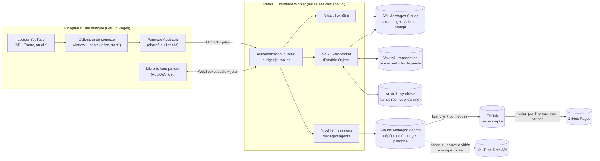

# Assistant IA intégré au site — analyse et plan

> **État au 2026-11-17 : plan proposé, rien n'est codé.** Ce document attend la validation de Thomas
> (voir « Décisions qui reviennent à Thomas », à la fin). Il est la référence des sessions qui
> travailleront sur l'assistant ; le résumé et les règles permanentes sont dans `CLAUDE.md`
> (section « Assistant IA »).

## Objectif

Un bouton **« Assistant »** sur toutes les pages, qui ouvre un panneau de discussion à l'écrit et à l'oral :

1. **Questions-réponses (priorité)** : une question sur le cours qu'on lit, une réponse presque
   instantanée, conforme au programme PTSI-PT (méthodes, notations, niveau).
2. **Mode vocal** : on parle, l'assistant répond à voix haute, en une à deux secondes au plus.
3. **Modifications** : « corrige cette démonstration », « reformule cette section », « modifie ce
   passage de la vidéo » ; l'IA modifie le dépôt elle-même, **par pull request**.

Au clic, la page envoie d'elle-même où l'on est (URL, matière, chapitre, section visible, texte
sélectionné, contenu du chapitre, instant de lecture d'une vidéo) : on n'a jamais à le réexpliquer.

---

## 1. Analyse du site actuel

### Hébergement

- **Site statique** servi par GitHub Pages depuis `main`, déployé par GitHub Actions (workflow
  « Déploiement GitHub Pages (statique) », qui publie le dépôt tel quel). Aucun serveur, aucun
  build, aucune variable secrète possible côté site.
- **PWA hors ligne** (`sw.js`) : HTML en stale-while-revalidate, assets en cache-d'abord, bump de
  `CACHE_VERSION` à chaque publication. Le service worker **laisse passer toute requête vers une
  autre origine** (`if (url.origin !== location.origin) return;`) : il ne gênera pas le relais.
- **100 % autonome** : les suites de tests vérifient **zéro requête externe**. Seule exception
  existante, l'onglet Vidéos, qui ne crée le lecteur `youtube-nocookie` **qu'au clic**. C'est le
  modèle à suivre : l'assistant ne fera aucune requête avant que Thomas l'ouvre et l'utilise.
- Dépôt et site **publics**. Le site partage l'origine `https://thomasmareel.github.io` avec
  toutes les autres pages GitHub Pages du compte (même `localStorage`).

### Organisation des pages

- **Une seule page** (`index.html`, ≈ 113 000 lignes, ≈ 11 Mo ; démarrage ≈ 7 s au téléphone,
  `docs/audit-2026-11.md` §4). Les « pages » sont des chapitres affichés par le JS.
- **Pilotage par les données** : le tableau `CHAPTERS` (171 chapitres : `id`, `prefix`, `name`,
  `matiere`, `sub`/`subLabel`, `panels`, `drawFn`…) et `CHAP_GROUPS` décrivent tout.
- **Conventions uniformes du DOM** : `div#chap-<id>`, panneaux `section#<prefix>-<onglet>`,
  surtitres `.sec-num` « §n · TITRE », exercices `.exo` (« EXO 01 », difficulté, solution
  `.toggle-sol`), encadrés typés (`.def-box`, `.prop-box`, `.method-box`…), `data-mat` partout.
- **Routage** `#<chapitre>/<onglet>` (`urlRouting`, `window.__syncHash`) ; **section courante**
  suivie par un IntersectionObserver (`window.__surSection`, `lastPos.s`) ; identifiants de
  section posés à la demande (`window.__preparerSections` : `<panneau>-sec-<i>`, `data-toc-label`).
- **Formules** : TeX dans le HTML source ; une fois rendues par MathJax, le TeX se relit par
  `MathJax.startup.document.math` (déjà fait par le module de recherche).
- **Cartes** : `window.FLASH_REGISTRY[prefix]` (questions/réponses), `FLASH_INSTANCES[prefix]`.
- **Vidéos** : table `window.__VIDEOS` (`{ yt, titre, duree, apercu, parties }`) ; côté dépôt,
  chaque vidéo a son `video/<cours>/chN/timeline.json` **versionné** (28 fichiers : scènes avec
  `t0`, `duree`, `titre` et phrases `{ id, debut, fin, ecrit, dit }`) et son `youtube.json` (id).
- Gabarits prêts à réutiliser : fenêtres `.fen` (focus piégé, Échap, retour Android par la liste
  `PAGES` d'`urlRouting`), toasts, `Store`, icônes `__icon`, jetons de couleur, typographie
  (`__typographier`), rendu paresseux (`typesetPanel`, `__apresRendu`).

### Génération des cours

- **Contenu écrit à la main** dans `index.html` par les sessions Claude Code, en suivant
  `CLAUDE.md` (≈ 100 Ko de conventions) et `GABARIT-CHAPITRE.md`, avec `tools/validate.py`,
  `tools/check_js.py` et la batterie Playwright (`tests/`). Figures calculées par des scripts
  Python **non versionnés** (scratchpad des sessions).
- **Vidéos** : kit `video/` (Manim, voix Camille de Mistral, `video/commun/*.py`, `rendu.sh`,
  `installer.sh`, mode d'emploi `video/README.md`, mise en ligne `video/YOUTUBE.md`) ; secrets
  Mistral et YouTube fournis par l'environnement cloud Claude Code « revisions-ptsi ».
- **PDF** : seul le cours de thermochimie a ses sources LaTeX dans le dépôt
  (`video/thermochimie/pdf/`, `pdflatex main.tex`, `scripts/calculs.py`).
- **`.claude/skills/` n'existe pas** : ni le kit vidéo ni la fabrication des PDF ne sont rangés en
  skills. Managed Agents ne trouverait donc rien à charger aujourd'hui (voir phase 3).

### Ce qui facilite le projet

| Atout | Usage pour l'assistant |
|---|---|
| `CHAPTERS` + conventions d'ids uniformes | un **seul collecteur de contexte** sert les 171 chapitres, sans attribut à ajouter partout |
| `#chapitre/onglet`, `__surSection`, `__preparerSections` | chapitre, onglet et section visible déjà connus |
| TeX relisible (`MathJax.startup.document.math`) | sélection et contenu envoyés en TeX propre, pas en glyphes |
| `__VIDEOS` + `timeline.json` phrase par phrase | instant de lecture → scène et phrase exacte (et la source à modifier en phase 4) |
| Modèle « rien d'externe avant le clic » (onglet Vidéos) | même garantie pour l'assistant, déjà testée |
| Gabarits `.fen`, retour Android, toasts, jetons | panneau cohérent avec la refonte, accessible |
| `CLAUDE.md` très complet, tests navigateur | un agent peut modifier le dépôt sans tout redécouvrir |
| Voix Camille et accès Mistral déjà en place | même voix que les vidéos ; compte et facturation existants |

### Ce qui bloque ou contraint

| Contrainte | Conséquence |
|---|---|
| Site statique public, sans serveur | **relais obligatoire** : toutes les clés vivent dans le relais, jamais dans la page |
| Origine `thomasmareel.github.io` partagée ; la **Sauvegarde exporte tout le `localStorage`** | le jeton de l'assistant ne doit pas aller dans `Store`/`localStorage` exporté (voir sécurité) |
| Tests « zéro requête externe », hors ligne d'abord | assistant inactif tant qu'on ne l'ouvre pas ; relais simulé dans les tests ; message hors ligne |
| `index.html` de 11 Mo, démarrage lent au téléphone | code de l'assistant chargé **à la demande** (fichier séparé), rien au démarrage |
| Pas d'étape de build | le contexte du chapitre est extrait **dans la page**, au clic, de façon déterministe |
| Lecteur YouTube sans `enablejsapi` | l'instant de lecture n'est pas lisible aujourd'hui (à ajouter en phase 0) |
| Aucune skill dans `.claude/skills/` ; kit vidéo lourd (Manim, LaTeX, ffmpeg) et secrets dans l'environnement Claude Code | à recréer pour Managed Agents : skills, paquets, coffre à secrets |
| Règle « chaque tâche publiée sur `main` sans demander » (`CLAUDE.md`) | **exception explicite** : ce que l'assistant modifie passe par une PR que Thomas fusionne |
| Les Actions ne lancent aucun test (déploiement seul) | une PR doit être vérifiée par l'agent, ou par un nouveau workflow de contrôle |
| Managed Agents et Voxtral temps réel sont récents (bêta) | interfaces susceptibles de changer ; garder le code fin et isolé |

---

## 2. Architecture retenue

### Vue d'ensemble



Principes :

1. **Aucune clé dans le front-end ni dans le dépôt.** Anthropic, Mistral, GitHub, YouTube,
   Cloudflare : uniquement dans les secrets du relais (ou les coffres Managed Agents), saisis par
   Thomas lui-même dans les consoles, jamais collés dans une conversation.
2. **Relais authentifié et plafonné** : sans jeton valide, il refuse tout ; avec, il applique un
   débit maximal et un budget journalier, doublés d'un plafond de dépenses chez Anthropic.
3. **Le contexte est collecté par la page** (elle seule sait ce qui est affiché), selon un schéma
   versionné ; le relais ne fait que l'assembler en prompt.
4. **Rien ne part avant le clic** ; hors ligne, le panneau le dit et ne tente rien.
5. **Les modifications ne touchent jamais `main` directement** : branche, pull request, fusion
   par Thomas. Garanti techniquement (droits GitHub), pas seulement par le prompt.

### Critique de l'architecture envisagée (ce qui est gardé, ce qui est adapté)

| Proposition | Avis |
|---|---|
| API Messages en streaming, modèle rapide, historique renvoyé, cache sur le chapitre | **Gardé.** Adapté : le contexte qui change à chaque question (section, sélection, instant vidéo) va dans le **dernier message**, hors du préfixe mis en cache, sinon chaque question invalide le cache. Le cache dure 5 min par défaut (option 1 h, écriture plus chère) : une lecture avec des questions espacées le perd ; à mesurer. |
| Haiku 5.5 ou Sonnet 5.5, effort bas | **Gardé, à trancher par une mini-évaluation** (≈ 30 vraies questions de Thomas, notées). Sur Sonnet 5.5, l'effort par défaut est `high` : le régler à `low` ; pour supprimer tout temps de réflexion, `thinking: {type: "between_tools"}` (sans outils, il ne réfléchit pas). Haiku 5.5 : effort par défaut `medium`. Proposition : Sonnet 5.5 par défaut, bouton **« Approfondir »** vers Opus 5.5 pour une question difficile. |
| Mode rapide (fast mode) | **Peu utile ici** : il n'existe que sur Opus 5.5 et Fable 5.2 (pas Haiku ni Sonnet), coûte le double, et accélère le **débit** de sortie, **pas le délai avant le premier mot** — or c'est ce délai qui compte à l'oral. À réserver éventuellement à « Approfondir ». |
| Voxtral Realtime (transcription + fin de parole) | **Gardé.** Point d'accès WebSocket `/v1/audio/transcriptions/realtime`, modèle `voxtral-mini-transcribe-realtime-3` (ou `-2602`), détection de tour (`turn.start`, `turn.eager_end`, `turn.end`, `turn.resume`, silence minimal 500 ms par défaut). Ajout : `context_bias` avec le vocabulaire du chapitre (le contrôle des vidéos transcrivait « Maxwell en paire »). |
| Voxtral TTS Realtime, phrase par phrase | **Gardé, simplifié** : ce n'est pas un modèle à part mais le point d'accès WebSocket `/v1/audio/speech/realtime` (modèle `voxtral-mini-tts-3`, déjà utilisé pour les vidéos), qui accepte le texte **au fil de l'eau** (`input_text.append`, `flush`, `end`) en mode `responsive`. On lui passe les morceaux de Claude dès qu'ils arrivent et on force la synthèse à chaque fin de phrase. Même voix que les vidéos (Camille). |
| Prompt adapté à l'oral, formules en mots | **Gardé**, plus un filet : un filtre retire tout reste de TeX avant la synthèse ; les formules utiles peuvent s'afficher dans le panneau sans être lues. |
| Managed Agents, PR, budget plafonné, skills de `.claude/skills` | **Gardé.** Adapté : le budget est un vrai plafond en dollars par session (`budget.max_list_cost`) ; « jamais sur `main` » est imposé par un **compte robot** sans droit d'écriture sur `main` ; **les skills sont à créer** (il n'y en a aucune) ; une étape intermédiaire 3a sans agent (fiche de demande) permet de commencer sans tout installer. |
| Relais N8N ou Cloudflare Worker | **Cloudflare Worker recommandé** (comparaison ci-dessous). N8N peut garder des automatisations lentes (notification d'une PR prête, bilan des dépenses). |
| Vidéos : régénérer, remettre en ligne, changer l'ID | **Gardé.** Ajout : relier chaque entrée de `__VIDEOS` à son dossier source (`src`), ne re-rendre que les scènes touchées, tenir compte du quota YouTube (≈ 6 envois par jour). |

### Relais : Cloudflare Worker ou N8N

| Critère | Cloudflare Worker | N8N auto-hébergé (Docker) |
|---|---|---|
| Flux SSE vers le navigateur | natif (`ReadableStream`) | possible selon les versions, moins direct |
| WebSocket audio (voix) | natif ; un Durable Object tient la session | non prévu pour relayer un WebSocket |
| Disponibilité | réseau mondial, toujours en ligne | dépend du PC ou du serveur de Thomas |
| Exposition | aucune machine personnelle exposée | il faut ouvrir l'instance sur Internet (tunnel, TLS) |
| Latence | proche de l'utilisateur | aller-retour par le domicile |
| Secrets | secrets chiffrés du Worker | identifiants N8N |
| Coût | offre gratuite très probablement suffisante (à confirmer à l'ouverture du compte) | déjà payé, mais maintenance |
| Code | JavaScript versionné dans le dépôt (`assistant/relais/`), sans aucun secret | flux graphiques, moins faciles à relire et à tester |

**Recommandation : Cloudflare Worker** pour tout le temps réel (texte, voix, lancement des
sessions de modification). Le dépôt étant public, le code du relais l'est aussi : sa sécurité
repose sur les secrets et l'authentification, pas sur le secret du code.

### Authentification et protection des crédits

Le site est public : sans authentification, n'importe qui pourrait vider les crédits ou lancer
des modifications. Proposition, par couches :

1. **Code personnel → jeton.** Thomas saisit une fois un long code (choisi par lui, gardé dans son
   gestionnaire de mots de passe) ; le relais, qui n'en connaît que l'empreinte, rend un **jeton
   signé** (HMAC, durée limitée, portée `chat`/`voix`). Le code n'est jamais stocké par la page.
   Changer la clé de signature du relais révoque tous les jetons.
2. **Où garder le jeton** : pas dans `Store` ni dans une clé `localStorage` ordinaire, car la
   Sauvegarde exporte tout le `localStorage` dans un fichier JSON. Soit une clé explicitement
   exclue de l'export, soit IndexedDB, soit en mémoire seulement (re-saisie à chaque visite).
   Rappel : toute autre page de `thomasmareel.github.io` peut lire ce stockage ; un **domaine
   personnalisé** pour le site supprimerait ce partage (décision D14).
3. **Portée « modifier » renforcée** : chaque demande de modification exige une confirmation
   forte — une **clé d'accès (passkey, WebAuthn)** liée au téléphone et au PC de Thomas
   (recommandé), ou la re-saisie du code — puis un écran récapitulatif « voici ce qui sera
   demandé à l'agent » avec bouton de confirmation.
4. **Plafonds** : débit (par exemple 30 requêtes par minute), budget journalier tenu par le relais
   d'après l'usage renvoyé par les API, **plafond de dépenses de l'espace de travail Anthropic**
   dédié à l'assistant (filet ultime), plafond équivalent chez Mistral s'il existe, budget par
   session Managed Agents.
5. **CORS** limité à `https://thomasmareel.github.io` (et `localhost` pour les tests) — commodité,
   pas une protection : la vraie barrière est le jeton.

Cloudflare Access n'est pas retenu : il repose sur un cookie de l'origine du Worker, qu'un appel
depuis `github.io` transporterait mal (cookies tiers bloqués par Safari et de plus en plus par
Chrome).

---

## 3. Collecte du contexte (structure uniforme)

### Choix : un collecteur unique, pas d'attributs `data-*` à semer partout

Le site est déjà uniforme : `CHAPTERS`, `chap-<id>`, `<prefix>-<onglet>`, `.sec-num`, `.exo`,
`data-mat`, `__VIDEOS`. Plutôt que d'ajouter des attributs à 171 chapitres (et de risquer
l'oubli), une seule fonction, **`window.__contexteAssistant()`**, lit ces sources et rend un objet
au **schéma versionné**. Deux petits ajouts seulement :

- dans `__VIDEOS`, un champ **`src`** par vidéo (`'video/em/ch2'`) qui relie la vidéo à son
  `timeline.json` (servi par GitHub Pages, même origine) et à ses sources (phase 4) ;
- le lecteur YouTube créé avec `enablejsapi=1&origin=…` et piloté par l'**API IFrame officielle**,
  chargée au moment du clic sur une vidéo (déjà un moment où YouTube est contacté) : on lit
  `getCurrentTime()` sans requête avant le clic.

### Schéma (version 1)

```js
{
  schema: 1,
  site: { version: 'ptsi-cache-v117', url: 'https://…/#maxwell/cours', annee: 2 },
  page: 'chapitre',                    // 'chapitre' | 'sommaire' | 'quiz' | 'aujourdhui' | …
  matiere: { code: 'physique', nom: 'Physique' },
  chapitre: { id: 'maxwell', prefix: 'mxw', nom: '…', partie: 'Électromagnétisme',
              tag: '…', annee: 2 },
  onglet: 'cours',                     // cours | video | meth | simu | flash | exos
  section: { num: '§3', titre: '…', id: 'mxw-cours-sec-3' },
  selection: { texte: '…', tex: '…', section: '§3' } | null,     // ≤ 4 000 signes
  exercice: { num: 'EXO 04', titre: '…', niveau: 2, solutionOuverte: false } | null,
  carte: { deck: 'mxw', rang: 12, question: '…', reponse: '…', face: 'recto' } | null,
  simulateur: { mode: '…', reglages: { I: '5,0 A', … } } | null,
  video: { yt: 'VZjnGjQ3ynU', titre: '…', t: 312.4, partie: 'Exercice 2',
           scene: { id: 'S7', titre: '…' }, phrase: { id: 'g3', ecrit: '…' },
           src: 'video/em/ch2' } | null,
  contenu: { empreinte: 'fnv1a:…', signes: 103593, texte: '…' }  // envoyé une fois par conversation
}
```

Règles :

- **Section visible** : celle de `__surSection` (ligne de lecture), à défaut la 1ʳᵉ du panneau.
- **Sélection** : mémorisée à chaque `selectionchange` dans `#app-main` (le clic sur le bouton
  ferait perdre la sélection) ; une formule rendue sélectionnée est rendue en TeX.
- **Contenu du chapitre** : texte canonique dans un ordre fixe (Cours, Méthodes, Exercices avec
  solutions, Cartes), formules en TeX `\( … \)` / `$$ … $$`, marqué « solution non ouverte par
  l'élève » le cas échéant. Taille mesurée le 2026-11-17 : médiane ≈ 21 500 signes (≈ 7 000 jetons),
  maximum ≈ 114 000 (≈ 35 000 jetons). Il est extrait **une fois par conversation** et réutilisé
  octet pour octet (condition du cache).
- **Instant vidéo** : `t` → scène (`t0 ≤ t < t0 + duree`) → phrase (`debut ≤ t − t0 ≤ fin`) du
  `timeline.json` ; partie cliquable correspondante de `__VIDEOS`.
- **Pages sans chapitre** (Sommaire, quiz, Aujourd'hui, Bilan) : `page` le dit, `chapitre` peut
  être nul ; le quiz donne la carte affichée.
- Le panneau montre un **aperçu « Ce que l'assistant voit »** (dépliable) : Thomas vérifie ce qui
  part, et c'est un outil de débogage.

### Contrat de compatibilité (pour toutes les sessions futures)

Le collecteur ne marche que si les conventions tiennent. À respecter dès maintenant :
`CHAPTERS` source de vérité, `div#chap-<id>`, panneaux `<prefix>-<onglet>`, surtitres
`.sec-num` « §n · … », exercices `.exo` dans `.exo-wrapper`, routage `#id/onglet`,
`window.__surSection`, `__preparerSections`, `__VIDEOS` (et son futur champ `src`),
`timeline.json` versionné pour chaque vidéo. Un nouvel onglet ou une nouvelle page doit être
déclaré au collecteur et couvert par la suite de tests `assistant` (phase 0).

---

## 4. Les phases

### Phase 0 — Collecte du contexte et interface (aucune IA)

- **Bouton « Assistant »** : en-tête ordinateur (icône + libellé, à côté de « Réviser »),
  feuille ⋯ et/ou barre `.mbar` au téléphone (décision D8) ; raccourci clavier à choisir parmi les
  touches libres (vérifier `#key-help-modal`).
- **Panneau** : à l'ordinateur, panneau latéral droit **non modal** (on continue à lire ; il
  prend la place du rail à partir de 1 360 px) ; tablette, tiroir ; téléphone, page plein écran
  intégrée au retour Android (`PAGES` d'`urlRouting`). Gabarit, jetons et règles de la refonte
  (cibles de 44 px, texte ≥ 13 px, sombre/clair, `visuel --strict`). Zone `aria-live` polie pour
  la réponse en cours.
- **Option « Demander à l'assistant »** sur une sélection (petite bulle près du texte choisi).
- `window.__contexteAssistant()` + aperçu ; ajout de `src` dans `__VIDEOS` ; API IFrame YouTube.
- Code dans un **fichier séparé chargé au premier clic** (`assistant/assistant.js`, décision D9) :
  rien de plus au démarrage du site.
- **Tests (nouvelle suite `assistant`)** : schéma valide sur les 171 chapitres × onglets (échantillon
  dans `test:rapide`, tout dans la batterie complète) ; section suivie au défilement ; sélection
  avec formule ; instant vidéo (lecteur simulé) ; **zéro requête externe** tant qu'on n'a rien
  envoyé ; panneau au clavier et en lecteur d'écran ; écrans du panneau ajoutés à `visuel`.
- Livrable : on ouvre le panneau, on voit exactement le contexte qui serait envoyé.

### Phase 1 — Discussion écrite

- **Relais** (`assistant/relais/`) : `POST /auth` (code → jeton), `POST /chat` (réponse en flux
  SSE), `GET /sante` ; secrets posés par Thomas dans le tableau de bord Cloudflare (jamais dans le
  dépôt ni dans la conversation). Déploiement : `wrangler deploy` depuis le PC de Thomas, ou depuis
  une session cloud si Thomas enregistre un jeton Cloudflare comme secret réseau.
- **Appel Claude** : SDK officiel `@anthropic-ai/sdk` dans le Worker, streaming, structure de prompt :

  ```text
  system[0]  rôle, programme PTSI-PT 2021, hors-programme signalé, notations du site,
             style (méthode avant résultat, renvois « §n »), format (TeX \( \) et $$ $$)  ← cache
  system[1]  fiche du chapitre : métadonnées + contenu canonique                          ← cache
  messages   historique de la conversation                                           ← cache auto
  dernier    question + contexte volatil (section, sélection, exercice, instant vidéo)
  ```

  Passage à l'oral dans la même conversation : un message système en cours de conversation
  (pris en charge par Sonnet 5.5, Haiku 5.5, Opus 5.5) plutôt qu'un nouveau `system`, pour garder
  le cache. Gérer `stop_reason: "refusal"` (repli serveur `fallbacks`) et les erreurs typées du SDK.
- **Affichage** : rendu progressif ; MathJax composé paragraphe par paragraphe ; renvois « §3 »
  cliquables (`navigateTo`) ; **aucun HTML du modèle injecté tel quel** (sous-ensemble autorisé :
  paragraphes, listes, gras, formules) ; boutons Copier, Approfondir, Nouvelle conversation.
- **Historique** : en mémoire, par chapitre, pour la session (décision D7).
- **Mesures** : délai avant le premier mot (objectif < 1 s avec le cache chaud), taux de lecture du
  cache (`usage.cache_read_input_tokens`), coût par conversation.
- **Mini-évaluation** avant de figer le modèle : ≈ 30 questions réelles (cours, méthode,
  exercice, piège de notation), réponses de Haiku 5.5 et Sonnet 5.5 notées par Thomas.
- Tests : relais simulé dans Playwright (`page.route` qui renvoie un flux SSE), affichage, erreurs
  (jeton expiré, hors ligne, budget atteint).

### Phase 2 — Voix

- **Chaîne** orchestrée **dans le relais** (un Durable Object par conversation vocale), pour éviter
  un aller-retour navigateur entre la transcription et Claude :

  ```mermaid
  sequenceDiagram
    participant N as Navigateur
    participant R as Relais
    participant S as Voxtral transcription
    participant C as Claude
    participant T as Voxtral synthèse
    N->>R: audio du micro (PCM 16 kHz, en continu)
    R->>S: audio
    S-->>R: texte partiel, puis turn.eager_end
    R->>C: requête anticipée (contexte déjà en cache)
    S-->>R: turn.end (ou turn.resume : on annule)
    C-->>R: premiers mots
    R->>T: texte au fil de l'eau, flush à chaque fin de phrase
    T-->>R: audio (deltas)
    R-->>N: audio, joué dès réception
  ```

- **Budget de latence** (estimations à mesurer, aucun fournisseur ne les garantit) : fin de parole
  détectée 0,3–0,5 s après le dernier mot (anticipée par `turn.eager_end`) ; premier mot de Claude
  0,4–0,9 s ; première phrase synthétisée 0,15–0,3 s ; réseau 0,1–0,2 s. Total visé : **1,1 à 1,9 s**.
- **Prompt oral** : phrases courtes, formules dites en mots (« q v vectoriel B »), jamais de TeX
  lu ; filtre de sécurité avant la synthèse ; formules éventuellement affichées sans être lues.
- **Navigateur** : `getUserMedia` (annulation d'écho), AudioWorklet pour la capture et la lecture,
  **interruption** (Thomas reparle : la voix s'arrête, la requête est annulée), transcription
  affichée des deux côtés. Mode micro ouvert ou appui pour parler (décision D10). Vérifier Safari
  sur iPhone/iPad et l'application installée (PWA).
- Variante à étudier : Mistral propose des **sessions client éphémères** (`/v1/client/sessions`,
  usage `realtime`, durée de vie limitée) qui permettraient au navigateur de parler directement à
  Voxtral ; moins de relais pour l'audio, mais un aller-retour de plus vers Claude. À comparer en
  mesures réelles.

### Phase 3 — Modifications par Claude Managed Agents

- **3a (sans agent, tout de suite utile)** : le mode « Modifier » du panneau prépare une **fiche
  de demande** (contexte exact + demande reformulée) que Thomas colle dans une session Claude Code
  de l'environnement « revisions-ptsi ». Aucun nouvel accès, et le format de la demande est rodé
  avant d'automatiser.
- **3b (Managed Agents)** :
  - **Agent** défini en fichier versionné (`assistant/agent/agent.md`, synchronisé par `ant apply`) :
    modèle (Opus 5.5 recommandé pour le code), prompt système (« lis `CLAUDE.md` ; travaille sur
    une branche `assistant/<date>-<sujet>` ; lance `validate.py`, `check_js.py` et les tests
    concernés ; bump de `CACHE_VERSION` dans la PR si un asset change ; ouvre une PR décrivant le
    changement ; **jamais de push sur `main`** ; rédaction originale »), outils bash/fichiers,
    recherche web coupée, serveur MCP GitHub pour la PR.
  - **Environnement** cloud, réseau `limited` (GitHub, gestionnaires de paquets ; `api.mistral.ai`
    et YouTube seulement pour les vidéos), paquets nécessaires (Python, Node ; Manim, LaTeX, ffmpeg
    pour la phase 4).
  - **Session** lancée par le relais : ressource `github_repository`
    (`https://github.com/thomasMareel/revisions-ptsi`, `checkout` sur `main`) avec un **jeton GitHub
    à grain fin** limité à ce dépôt (contenu et pull requests), injecté par le proxy git sans
    jamais entrer dans le bac à sable ; **`budget.max_list_cost`** (par exemple 3 $) ; secrets
    Mistral/YouTube dans un **coffre** (`environment_variable`, substitués à la sortie) pour les
    vidéos seulement.
  - **Sécurité de `main`** : le jeton est celui d'un **compte robot** qui a l'écriture sur le dépôt
    mais qu'une règle GitHub (ruleset) empêche de pousser sur `main` ; Thomas et les sessions
    Claude Code gardent leur flux actuel (décision D11). Un workflow léger de contrôle des PR
    (`validate.py`, `check_js.py`, éventuellement `test:rapide`) est recommandé : la sandbox de
    l'agent pourrait ne pas avoir Chromium.
  - **Suivi dans le panneau** : le relais relaie les événements de la session (messages,
    résumés d'outils) puis le lien de la PR ; Thomas relit le diff sur GitHub et fusionne.
  - Option : une **« outcome »** Managed Agents (grille de 5 à 10 critères : contrôles verts,
    bump fait, description claire…) pour que l'agent itère jusqu'à une PR propre (coût en plus).
- **Skills à créer** dans `.claude/skills/<nom>/SKILL.md` (un niveau de profondeur exactement ;
  chargées automatiquement par Managed Agents au montage du dépôt, et aussi par Claude Code) :
  - `modifier-chapitre` : ancres, conventions, contrôles, publication par PR ;
  - `cours-video` : le kit `video/` (étapes, contrôles), en renvoyant à `video/README.md` ;
  - `cours-pdf` : `video/thermochimie/pdf/` (`calculs.py`, `pdflatex` deux passes) ;
  - `remplacer-video` (phase 4).
  Chaque `SKILL.md` reste court et **renvoie aux documents de référence** (`CLAUDE.md`,
  `video/README.md`) au lieu de les recopier, pour qu'il n'y ait qu'une source de vérité. Ces skills
  sont des instructions d'agent : elles font partie de la zone de confiance (à relire si un jour
  quelqu'un d'autre propose des PR).

### Phase 4 — Vidéos

« Modifie ce passage de la vidéo » : le contexte donne `yt`, l'instant, la scène, la phrase et
`src`. L'agent :

1. retrouve la phrase dans `video/<cours>/chN/segments.py` et la scène dans `scenes.py` ;
2. corrige, puis ne relance que ce qui est touché (`audio.py`, `ancres.py`, rendu des scènes
   concernées, `planche.py` pour le contrôle visuel, `assemble.py`) ;
3. envoie la nouvelle version **en non répertorié** (`youtube.py envoi`) — YouTube ne permet pas de
   remplacer le fichier d'une vidéo en ligne ;
4. met à jour `__VIDEOS` (`yt`, `duree`, `parties`), l'aperçu `media/videos/*.webp`,
   `youtube.json`, le tableau « Vidéos livrées » de `video/README.md`, et bump `CACHE_VERSION` ;
5. ouvre la PR ; le MP4 et le SRT sont déposés dans les sorties de session
   (`/mnt/session/outputs/`) pour que Thomas les récupère.

Points d'attention : quota YouTube (un envoi coûte ≈ 1 600 unités sur 10 000 par jour), durée de
rendu (plusieurs dizaines de minutes de bac à sable), sort de l'ancienne vidéo (décision D12).

---

## 5. Coûts (ordres de grandeur, tarifs relevés le 2026-11-17)

| Usage | Hypothèses | Coût estimé |
|---|---|---|
| Conversation écrite de 10 questions, plus gros chapitre (≈ 35 000 jetons), Sonnet 5.5 | 1 écriture du cache, 9 lectures, ≈ 400 jetons de réponse | ≈ 0,18 $ |
| Même conversation, chapitre médian (≈ 7 000 jetons) | idem | ≈ 0,08 $ |
| Même chose avec Haiku 5.5 | prix ≈ 20 fois plus bas | ≈ 0,01 $ |
| « Approfondir » (Opus 5.5) | 4 $ / 20 $ par million de jetons (8 $ / 40 $ en mode rapide) | quelques centimes par question |
| Voix (Voxtral transcription + synthèse) | tarifs à relever dans la console Mistral | à mesurer en phase 2 |
| Session de modification (Managed Agents) | jetons du modèle + 0,08 $ par heure de session | ≈ 1 à 5 $, plafonnée par session |

Tarifs Claude : Sonnet 5.5 à 2 $ / 10 $ par million de jetons (lecture du cache 0,10 $), Haiku 5.5
à 0,10 $ / 0,50 $. **L'API se paie à part d'un abonnement Claude** : il faut un compte de la Console
Claude avec facturation (et de préférence un espace de travail dédié, plafonné).

---

## 6. Risques

| Risque | Gravité | Parade |
|---|---|---|
| Clé exposée (front-end, dépôt, conversation) | critique | clés seulement dans le relais et les coffres ; contrôle dans `validate.py` (motifs de clés) à ajouter en phase 1 |
| Jeton volé (Sauvegarde, origine partagée, poste prêté) | élevée | jeton à durée limitée, hors export, révocable ; passkey pour « modifier » ; budgets plafonnés |
| Crédits consommés par erreur ou par une boucle | élevée | débit et budget journalier du relais, plafond Anthropic, `max_list_cost` par session |
| Agent qui casse le site ou pousse sur `main` | élevée | compte robot sans droit sur `main`, PR obligatoire, contrôles automatiques, fusion par Thomas |
| Réponse fausse (physique, maths) ou hors programme | moyenne | prompt fondé sur le chapitre et le programme, renvois « §n » vérifiables, bouton « Approfondir », signalement d'une réponse douteuse |
| Latence vocale au-delà de 2 s | moyenne | fin de parole anticipée, cache chaud, synthèse au fil de l'eau, mesures instrumentées ; repli : Haiku à l'oral |
| Injection de contenu dans la réponse affichée | moyenne | rendu par liste blanche, jamais `innerHTML` brut |
| Démarrage du site ralenti | moyenne | code chargé au premier clic, rien au démarrage, tests de performance existants |
| Cache de prompt souvent perdu | faible | contexte volatil hors préfixe ; TTL 1 h si les mesures le justifient |
| Fonctions en bêta qui changent (Managed Agents, Voxtral temps réel) | moyenne | code mince et isolé dans le relais, versions des SDK figées |
| Données envoyées à Anthropic et Mistral ; sessions Managed Agents conservées jusqu'à suppression | faible (usage personnel) | contenu = cours publics + questions ; purge des sessions après fusion |
| Voix ou micro instables sur iPhone/iPad et en PWA | moyenne | essais tôt en phase 2 ; repli sur l'écrit |
| Accessibilité du panneau | moyenne | mêmes exigences que la refonte (`visuel --strict`, clavier, lecteur d'écran) |
| Droit d'auteur (manuels privés) | moyenne | règle de rédaction originale reprise dans le prompt de l'agent et ses skills |

---

## 7. Organisation prévue dans le dépôt

```text
assistant/
  assistant.js        module du panneau, chargé au premier clic       (phases 0 à 2)
  relais/             code du Cloudflare Worker, sans aucun secret    (phases 1 et 2)
  prompts/            prompts système versionnés : ecrit, oral, modif (phases 1 à 3)
  agent/              définition de l'agent et de l'environnement     (phase 3)
.claude/skills/       modifier-chapitre, cours-video, cours-pdf, remplacer-video
tests/suites/assistant.js
docs/assistant-ia.md  ce document (à tenir à jour à chaque phase)
```

GitHub Pages publiera aussi `assistant/relais/` et les prompts : sans conséquence (aucun secret).

---

## 8. Décisions qui reviennent à Thomas

Chaque ligne donne la recommandation ; rien ne sera codé avant validation.

| # | Décision | Recommandation |
|---|---|---|
| D1 | Relais : Cloudflare Worker ou N8N | Worker (temps réel, voix) ; N8N facultatif pour des automatisations lentes |
| D2 | Comptes : Cloudflare (gratuit), **Console Claude avec facturation API**, Mistral (existant) | créer un espace de travail Anthropic dédié, plafonné |
| D3 | Authentification | code personnel → jeton signé ; passkey pour « modifier » |
| D4 | Budgets | par exemple 10 €/mois pour l'écrit et la voix, 3 $ par session de modification, 20 $/mois pour Managed Agents |
| D5 | Modèle par défaut | Sonnet 5.5 effort bas, « Approfondir » sur Opus 5.5 ; à confirmer par la mini-évaluation contre Haiku 5.5 |
| D6 | Pédagogie sur les exercices | proposer d'abord un indice, la solution complète sur demande ; ne pas dévoiler une solution non ouverte sans demande explicite |
| D7 | Historique des conversations | en mémoire, par chapitre, pour la session ; pas de stockage durable au début |
| D8 | Place du bouton au téléphone | dans la barre `.mbar` si la place le permet, sinon la feuille ⋯ (aucune barre fixe en bas) |
| D9 | Code de l'assistant hors d'`index.html` | oui, fichier chargé à la demande (exception assumée à « un seul fichier servi ») |
| D10 | Voix : micro ouvert ou appui pour parler ; voix Camille | appui pour parler d'abord (plus fiable), micro ouvert ensuite ; Camille |
| D11 | GitHub : compte robot + règle sur `main`, contrôle automatique des PR | oui aux deux ; Thomas seul fusionne |
| D12 | Ancienne vidéo après remplacement | la passer en privé après la fusion (liens morts évités par la mise à jour du site) |
| D13 | Données chez Anthropic et Mistral, sessions conservées | acceptable pour un usage personnel ; purge des sessions après fusion |
| D14 | Domaine personnalisé pour le site | facultatif ; supprime le partage d'origine avec les autres pages du compte |

**Ordre proposé** : phase 0 → phase 1 (et mini-évaluation) → 3a → phase 2 → 3b → phase 4.
La voix passe après la fiche de demande (3a) car celle-ci rend service tout de suite à faible coût ;
l'ordre reste à ta main.

## Sources consultées

- Claude Managed Agents : vue d'ensemble, accès GitHub (platform.claude.com, lus le 2026-11-17) ;
  budgets de session, coffres, skills du dépôt (référence de l'API Claude de la session).
- Mode rapide (platform.claude.com/docs/en/build-with-claude/fast-mode, lu le 2026-11-17).
- Mistral audio : `docs.mistral.ai` n'était **pas accessible** depuis la session (réseau) ; les noms
  de modèles viennent de `GET /v1/models` (2026-11-17) et les protocoles temps réel du SDK officiel
  `mistralai` 3.7.0 (`/v1/audio/transcriptions/realtime`, `/v1/audio/speech/realtime`,
  `/v1/client/sessions`). À relire dans la documentation Mistral avant la phase 2.
